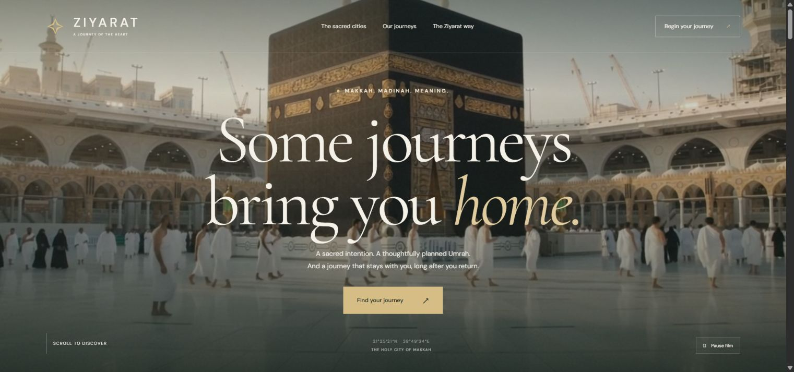

# Ziyarat — A journey of the heart

A custom cinematic Umrah agency website using the supplied Makkah and Madinah videos and photographs.

**Live website:** https://ziyarat-umrah.vercel.app

## Preview

Run `python -m http.server 5400 --bind 127.0.0.1` from this directory and open http://localhost:5400.

## Features

- Full-screen Makkah video and editorial typography
- Scroll-driven, pinned transition from Makkah to Madinah
- Responsive journey cards with duration filters
- Journey planning form with a downloadable enquiry
- FAQ accordion, mobile navigation and reduced-motion controls
- Videos pause when offscreen or the browser tab is hidden

Run `npm run check` for JavaScript syntax validation and `npm run build` to create `public/` for static hosting. No dependencies are required.

## Deployment

Production is hosted on Vercel project `ziyarat`. Release updates from this directory with `vercel --prod --yes`. The GitHub source is maintained on `main` in [MuhammadWaizImran/Umrah-Agency-Website](https://github.com/MuhammadWaizImran/Umrah-Agency-Website). Automatic deployments on Git pushes require connecting the repository through the Vercel GitHub integration.

## Business configuration

Agency name: Ziyarat. WhatsApp number, email, prices and confirmed inclusions have not been supplied. Package descriptions are proposed starting points. The planner produces a local download and does not transmit personal data or confirm bookings. Add verified agency contact details and booking terms before accepting enquiries online.

## Media

All site photography and video came from the user-supplied files in the parent workspace. Images are optimised as WebP and both original videos are stored locally. No new Higgsfield video has been generated; its account connection is pending.
